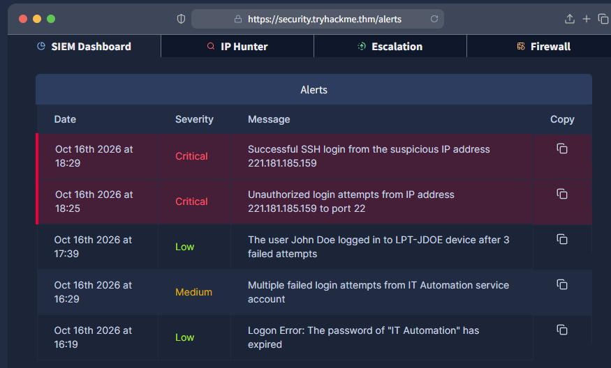
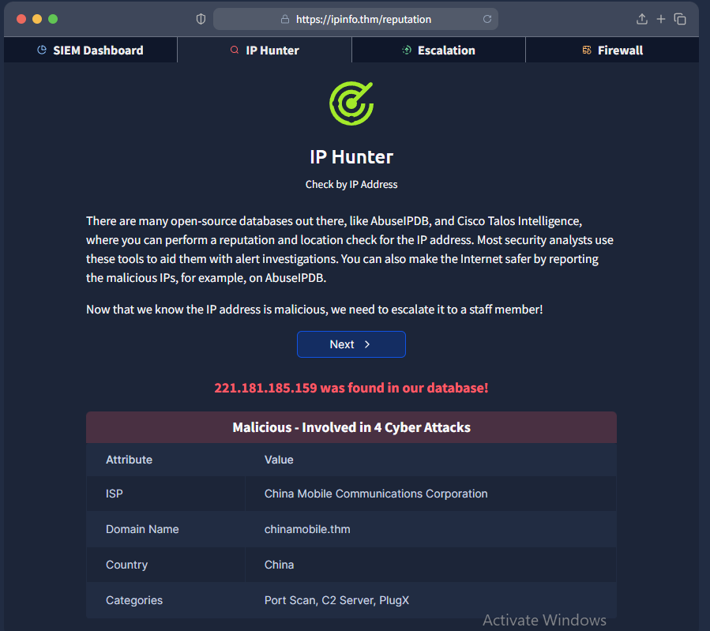

Junior security analyst

Junior security analyst Intro 
    
## Alert Investigation & IP Reputation
### 1. SIEM Alert Review
    
Reviewed the SIEM dashboard and identified two critical alerts involving suspicious SSH activity from `221.181.185.159`:
    
- Multiple unauthorised login attempts targeting port 22.
- A successful SSH login from the same IP address.
    
These alerts indicated a potential compromise and required further investigation.
    
    
2. IP Reputation Check
    
Used the IP Hunter tool to investigate the suspicious IP address. The results identified it as malicious, with four reported cyberattack associations, including port scanning, command-and-control (C2), and PlugX.
    
This provided additional context supporting the need to escalate the alerts for further investigation.
    

    
 ### Key Takeaways
    
- Identifying and prioritising critical SIEM alerts.
- Recognising suspicious SSH authentication activity.
- Using IP reputation tools for threat intelligence.
- Understanding the importance of incident escalation.
