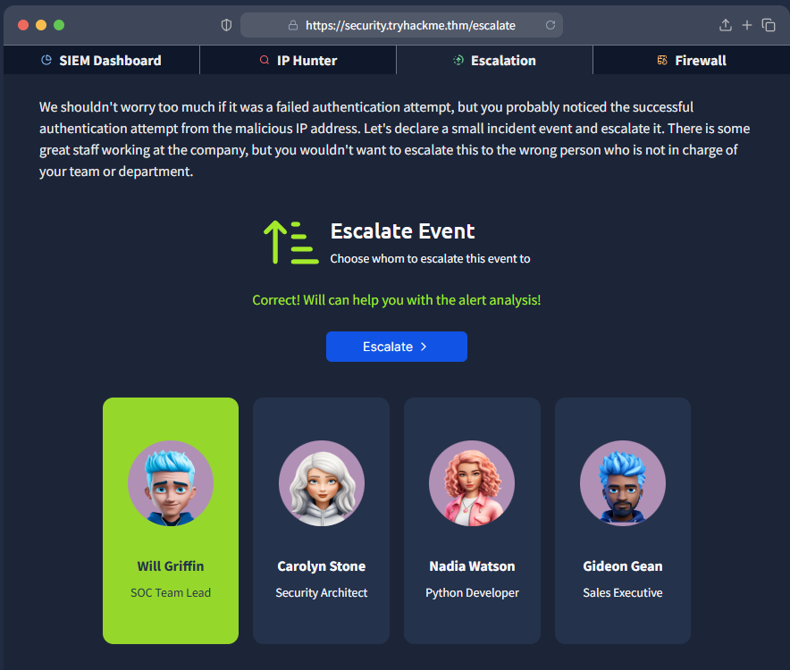
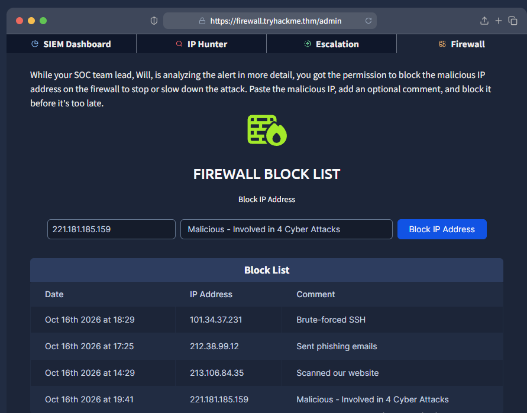

## Alert Investigation & IP Reputation
### 1. SIEM Alert Review
    
Reviewed the SIEM dashboard and identified two critical alerts involving suspicious SSH activity from `221.181.185.159`:
    
- Multiple unauthorised login attempts targeting port 22.
- A successful SSH login from the same IP address.
    
These alerts indicated a potential compromise and required further investigation.
    
    
2. IP Reputation Check
    
Used the IP Hunter tool to investigate the suspicious IP address. The results identified it as malicious, with four reported cyberattack associations, including port scanning, command-and-control (C2), and PlugX.
    
This provided additional context supporting the need to escalate the alerts for further investigation.
    

    
### 3. Escalation

After confirming the IP was malicious, the next step was to escalate the incident.  
A successful authentication from a known-bad IP is more serious than a simple failed login attempt, so it needed to be handed over to the correct person.

Escalated the event to **Will Griffin** (SOC Team Lead), as he is the appropriate person to continue the investigation.

### 4. Firewall Blocking

While Will analysed the alert in more detail, permission was given to block the malicious IP on the firewall to stop or slow down any further activity.

- IP Address: `221.181.185.159`
- Comment: `Malicious - Involved in 4 Cyber Attacks`

The IP was successfully added to the firewall block list.

### Key Takeaways

- Identifying and prioritising critical SIEM alerts.
- Recognising suspicious SSH authentication activity.
- Using IP reputation tools for threat intelligence.
- Escalating incidents to the correct person (SOC Team Lead).
- Taking containment action by blocking malicious IPs on the firewall.
