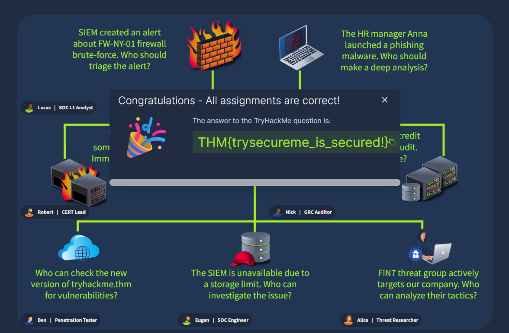
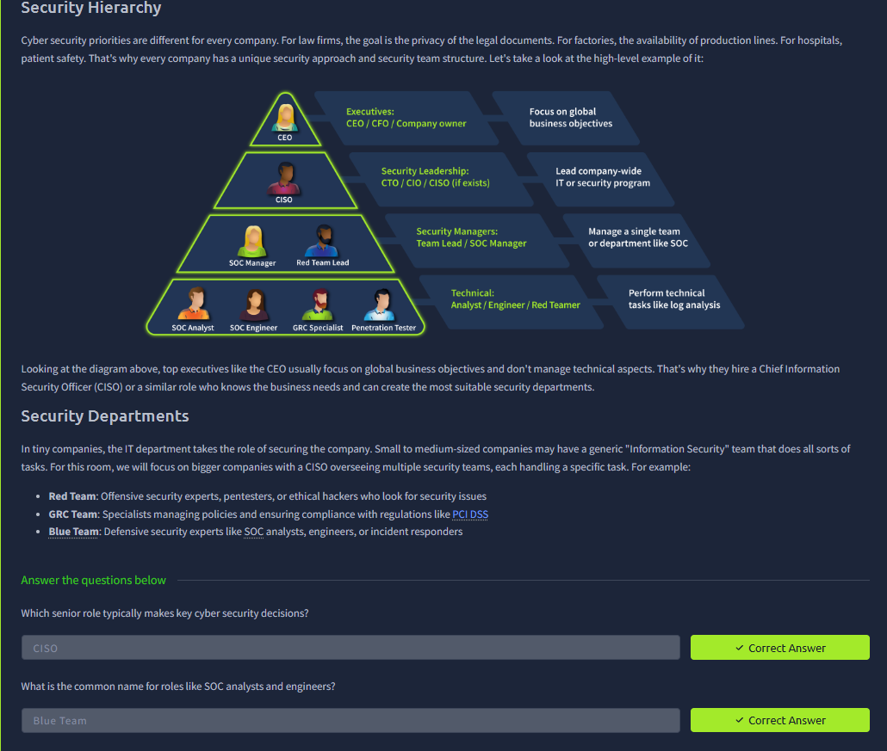
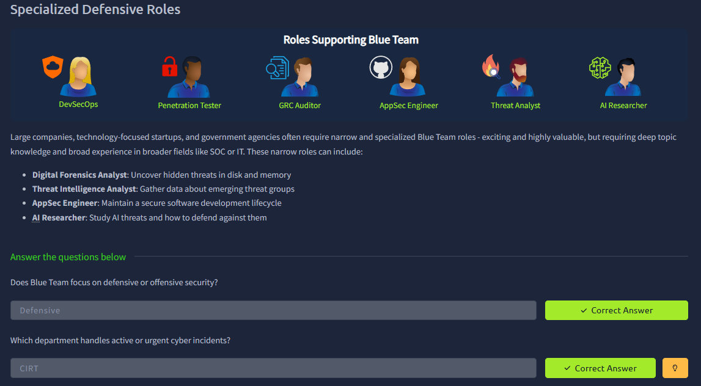
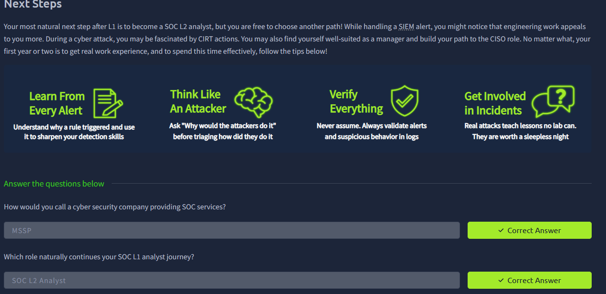

# SOC Role in Blue Team

## 1. Role Assignment Exercise

Completed the interactive exercise matching different security scenarios to the correct team members:

- SIEM created an alert about FW-NY-01 firewall brute-force → **Lucas** (SOC L1 Analyst) for triage
- The HR manager Anna launched a phishing malware → deep analysis required
- Who can check the new version of tryhackme.thm for vulnerabilities? → **Ben** (Penetration Tester)
- The SIEM is unavailable due to a storage limit → **Eugen** (SOC Engineer)
- FIN7 threat group actively targets our company → **Alice** (Threat Researcher)

All assignments were correct and the room flag was obtained:

`THM{trysecureme_is_secured!}`

## 2. Security Hierarchy

Reviewed the typical security hierarchy found in larger organisations:

- **Executives** (CEO / CFO / Company owner) – Focus on global business objectives
- **Security Leadership** (CTO / CIO / CISO) – Lead the company-wide IT or security programme
- **Security Managers** (Team Lead / SOC Manager) – Manage a single team or department (e.g. SOC)
- **Technical roles** (Analyst / Engineer / Red Teamer) – Perform technical tasks such as log analysis

**Key answers from this section:**
- Which senior role typically makes key cyber security decisions? → **CISO**
- What is the common name for roles like SOC analysts and engineers? → **Blue Team**

## 3. Specialized Defensive Roles

Explored specialised roles that support the Blue Team in larger companies, technology-focused startups, and government agencies:

- **Digital Forensics Analyst** – Uncover hidden threats in disk and memory
- **Threat Intelligence Analyst** – Gather data about emerging threat groups
- **AppSec Engineer** – Maintain a secure software development lifecycle
- **AI Researcher** – Study AI threats and how to defend against them

**Key answers from this section:**
- Does Blue Team focus on defensive or offensive security? → **Defensive**
- Which department handles active or urgent cyber incidents? → **CIRT**

## 4. Next Steps

After completing SOC Level 1, the most natural progression is becoming a **SOC L2 Analyst**. Other possible paths include focusing on engineering work, joining a CIRT, or eventually moving toward a CISO role.

Advice for the first year or two:
- Learn from every alert
- Think like an attacker
- Verify everything
- Get involved in real incidents

**Key answers from this section:**
- How would you call a cyber security company providing SOC services? → **MSSP**
- Which role naturally continues your SOC L1 analyst journey? → **SOC L2 Analyst**

## Key Takeaways

- Understanding who handles which type of security task is essential for effective escalation
- The Blue Team focuses on defensive security
- CIRT handles active / urgent incidents
- The natural next step after SOC L1 is SOC L2 Analyst
- Larger organisations have more specialised roles (Threat Intel, AppSec, Digital Forensics, etc.)
